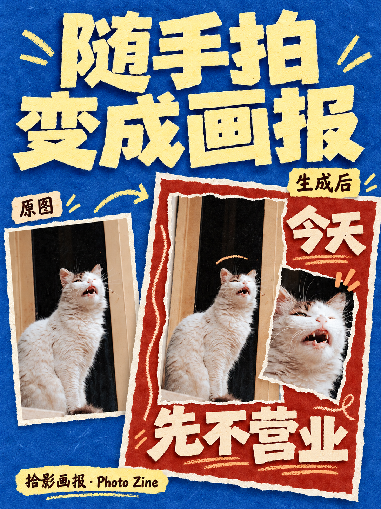
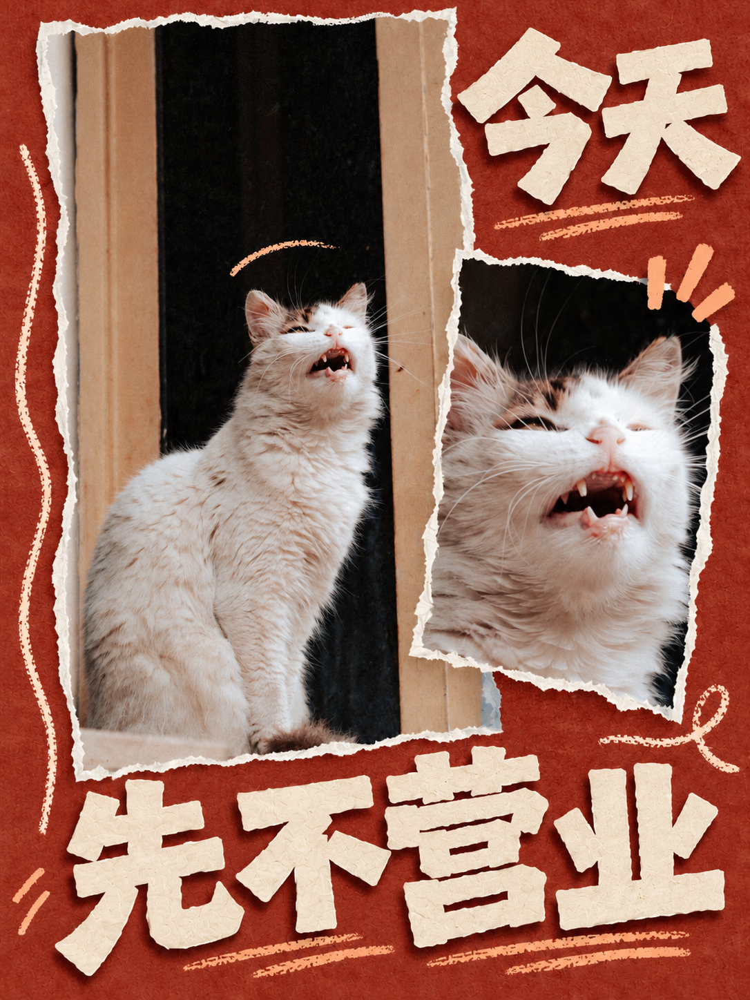
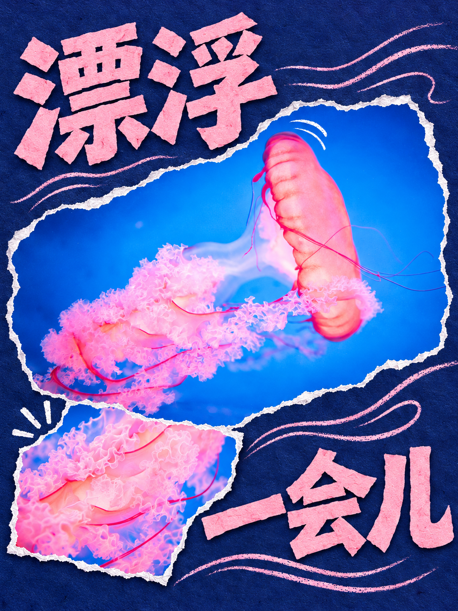
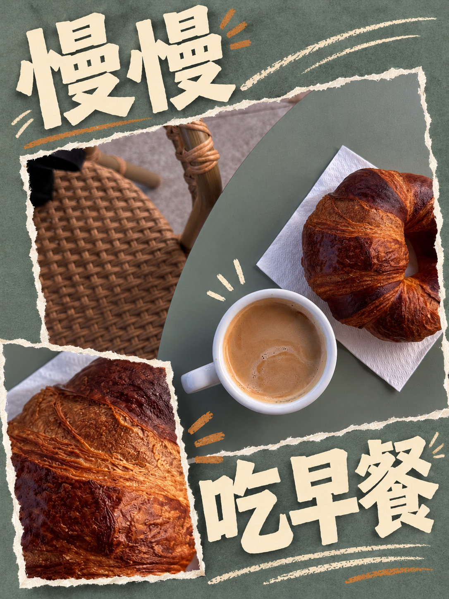
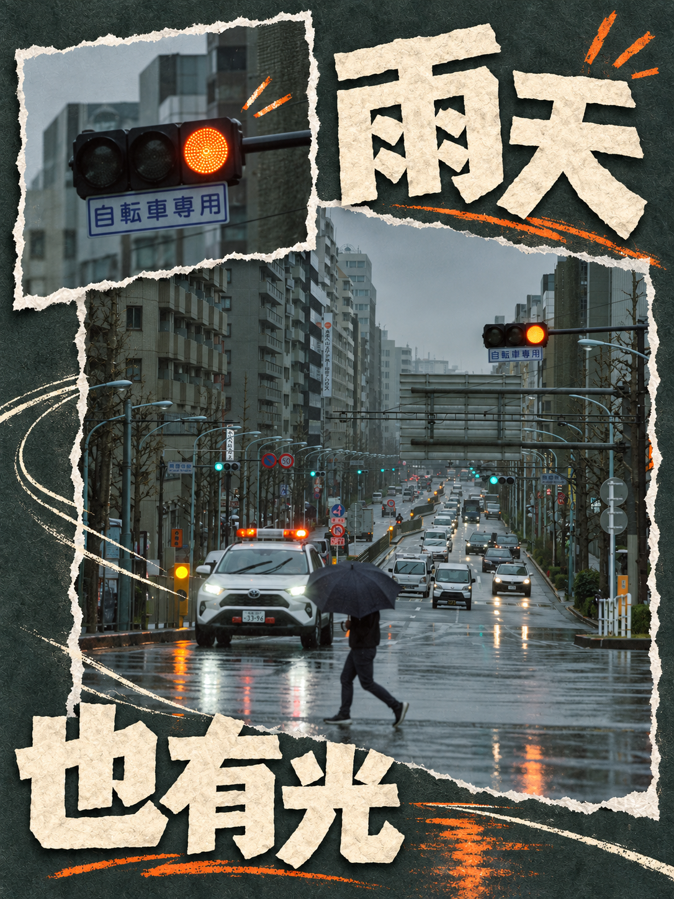

# 拾影画报 · Photo Zine

把相册里的照片，变成有纸张触感的剪贴画报。

「拾影画报」是一套照片编排 Skill：依据原图组织主图与放大细节，提取配色，并用纸片文字、撕纸边与手绘线条建立节奏。默认输出一张 3:4 画报，不加风格标签或工具水印。

[下载 Skill ZIP](downloads/photo-editorial.zip) · [使用说明](docs/usage.md) · [English](docs/README.en.md) · [测试记录](docs/test-notes.md) · [摄影来源](docs/credits.md)



## 五张实拍，五种组织方式

|猫咪：表情特写|水母：曲线与漂浮感|
|---|---|
|||

|篮筐：斜切与运动感|早餐：色彩和酥皮纹理|
|---|---|
|||



## 安装与开始

下载 [photo-editorial.zip](downloads/photo-editorial.zip)，解压得到完整的 `photo-editorial` 文件夹，将其安装到所用 AI 工具的 skills 目录。也可以把 ZIP 交给支持本地 skills 的 AI 助手，让它安装并检查 `SKILL.md`、`references/`、`assets/` 是否完整。

本技能需要能够读取本地技能文件、查看照片并进行图片生成或编辑的 AI 工具。技能包不包含模型服务、额度或 API 密钥；图片能力与费用由使用的工具决定。

上传照片后说：

> 使用 $photo-editorial，把这张照片做成纸感剪贴画报。保留主体，从原图取色，加上与题材相符的手绘线条。

可以附上标题、画幅与装饰密度，例如：

> 标题用“今天先不营业”，保留照片中猫咪的表情，细节图大一些，装饰做成有长短变化的三四组线条。

## 设计规则

- 先看照片的主体、空间、光线和可用局部，再安排版式。
- 主图保留场景，细节图提供新的观看尺度，不把细节图缩成小贴纸。
- 配色取自原图，不固定套用蓝黄或米白模板。
- 手绘线条有长短、实虚、疏密变化，并与题材有关。
- 中文标题保持完整可读，图像、纸边和装饰不遮挡关键笔画。
- 精修锁定已经认可的构图，只改用户指出的问题。

## 输出边界

案例以生成式编辑完成，部分纹理、物件和细小文字可能被重新描绘；这些图片不是原片的逐像素排版。需要照片像素不变时，应明确要求保留原始图像文件的分层排版。本次五张样例验证的是生成式路线，没有验证所有工具或所有照片。

案例原片来自公开授权摄影，详见[来源与摄影师](docs/credits.md)。

## 目录

```text
SKILL.md                    技能入口
agents/openai.yaml          显示名称与调用示例
assets/                     纸感剪贴视觉标尺
references/                 构图、配色、线条、提示词与检查
examples/                   实拍案例与宣传封面
downloads/photo-editorial.zip  可安装技能包
docs/                       安装、测试、来源与发布文案
knowledge/                  飞书知识库条目原稿
```

版本：v1.0.0 · 整理日期：2026-10-29。
